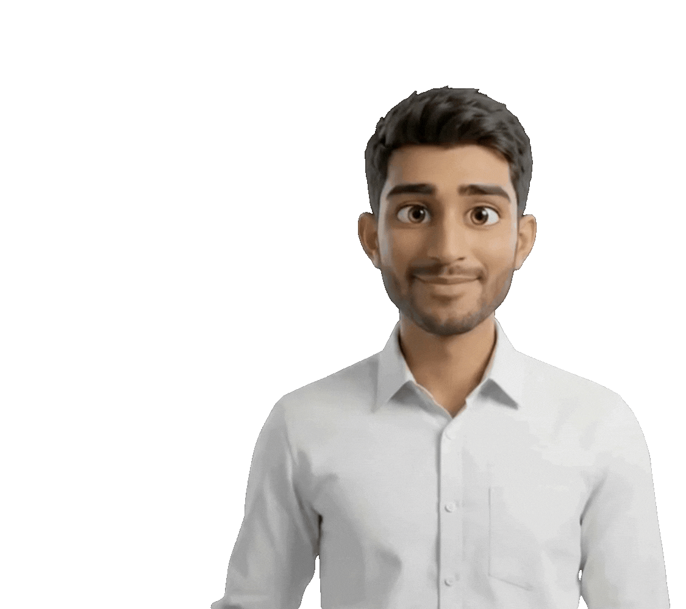

<!-- ═══════════════════════════ HEADER BANNER ═══════════════════════════ -->

<!-- HEADER BANNER -->

 

<!-- ✏️ EDIT: your rotating tagline (separate lines with semicolons, use + for spaces) -->

  

 

<!-- ═══════════════════════════ ABOUT ME ═══════════════════════════ -->
<h2 align="center">ABOUT ME</h2>
<table>
<tr>
<td width="60%" valign="top">

<!-- ✏️ EDIT: write your own story. Keep it short and punchy. -->
I'm an AI/ML & Software Engineer passionate about building scalable software systems, data-driven solutions, and intelligent applications, from machine learning models and deep learning systems to Agentic AI, RAG systems, and LLM-powered applications. I enjoy turning complex problems into practical, reliable products — from developing ML models and backend APIs to exploring data, cloud infrastructure, and cybersecurity. My work also extends to AI research, with publications in IEEE.

- **AI/ML:** Machine Learning, Deep Learning, Computer Vision, NLP & Explainable AI.

- **Modern AI:** Agentic AI, LLMs, RAG Pipelines, Hybrid Retrieval & AI Agents.

- **AI Engineering:** Model Evaluation, Prompt Engineering, Reranking, Inference APIs & Deployment.

- **Software Development:** Backend Engineering, REST APIs, Databases & System Design.

- **Research:** Applied AI, Deep Learning & IEEE Publications.

- **Beyond AIML & SDE:** Data Engineering, Cloud-Native Systems & Cybersecurity.

<td width="40%" align="center" valign="middle">
  
</td>
</tr>
</table>
 
<!-- ═══════════════════════════ TECH STACK ═══════════════════════════ -->

<h2 align="center">Tech Stack</h2>

  <h3>Languages</h3>
  

  <h3>ML, DL & Computer Vision</h3>
  

  <h3>LLM Frameworks & Agentic AI</h3>
  

    
    &nbsp;&nbsp;
    
    &nbsp;&nbsp;
    
    &nbsp;&nbsp;
    
    &nbsp;&nbsp;
    
  

  <h3>LLMs, Models & AI Platforms</h3>
  

    
    &nbsp;&nbsp;
    
    &nbsp;&nbsp;
    
    &nbsp;&nbsp;
    
    &nbsp;&nbsp;
    
  

  <h3>Frontend</h3>
  

  <h3>Backend & Databases</h3>
  

  <h3>Cloud & DevOps</h3>
  

 

<!-- ═══════════════════════════ FEATURED PROJECTS ═══════════════════════════ -->

<h2 align="center">Featured Projects</h2>

<table>
  <tr>
    <td width="33%" valign="top">
      
      
<a href="https://github.com/VIKASSAGAR891/Cloud-Agentic-Cyber-Defense">View Project →</a>

    </td>
    <td width="33%" valign="top">
      
      
<a href="https://github.com/VIKASSAGAR891/RAG-POLICY">View Project →</a>

    </td>
    <td width="33%" valign="top">
      
      
<a href="https://github.com/VIKASSAGAR891/Context-Aware-Multimodal-Narrative-Generation-Using-Hierarchical-Personalization-">View Project →</a>

    </td>
  </tr>
  <tr>
    <td width="33%" valign="top">
      
      
<a href="https://github.com/VIKASSAGAR891/Enterprise-Service-Request-Management-System">View Project →</a>

    </td>
    <td width="33%" valign="top">
      
      
<a href="https://github.com/VIKASSAGAR891/YOLO-BASED-THERMAL-ANOMALY-DETECTION">View Project →</a>

    </td>
    <td width="33%" valign="top">
      
      
<a href="https://github.com/VIKASSAGAR891/Secure-Cloud-Access-and-Network-Segmentation-for-a-Hybrid-Enterprise">View Project →</a>

    </td>
  </tr>
  <tr>
    <td width="33%" valign="top">
      
      
<a href="https://github.com/VIKASSAGAR891/Deep-Feature-Skin-Cancer-Detection">View Project →</a>

    </td>
    <td width="33%" valign="top">
      
      
<a href="https://github.com/VIKASSAGAR891/securewater-iot-cybersecurity">View Project →</a>

    </td>
    <td width="33%" valign="top">
      
      
<a href="https://github.com/VIKASSAGAR891/visionai-model-serving-platform">View Project →</a>

    </td>
  </tr>
  <tr>
    <td width="33%" valign="top">
      
      
<a href="https://github.com/VIKASSAGAR891/SHAP-BASED-PHISHING-DETECTION">View Project →</a>

    </td>
    <td width="33%" valign="top">
      
      
<a href="https://github.com/VIKASSAGAR891/REALTIME_COLLABORATIVE_EDITOR">View Project →</a>

    </td>
    <td width="33%" valign="top">
      
      
<a href="https://github.com/VIKASSAGAR891/chatbot_ai_study">View Project →</a>

    </td>
  </tr>
</table>

 
<!-- ================= CERTIFICATIONS ================= -->
<h2 align="center">Certifications</h2>

  Fundamentals of Deep Learning — NVIDIA
   
  Microsoft Certified: Azure AI Fundamentals — Microsoft
   
  Database Programming with PL/SQL — Oracle
   
  Building Autonomous AI Agents with LangGraph — Packt
   
  Introduction to Machine Learning — Duke University

 
<!-- ═══════════════════════════ GITHUB STATS ═══════════════════════════ -->

<h2 align="center">GitHub Analytics</h2>

 

<h2 align="center">Contribution Activity</h2>

  

 

<!-- ================= BLOG / LATEST ================= -->

  <h2>Latest Writing & Publications</h2>

  

    <a href="https://github.com/VIKASSAGAR891/Cloud-Agentic-Cyber-Defense">Cloud-Native Agentic Cyber Defense Platform for Zero-Day Attack Mitigation</a>
     
    <a href="https://github.com/VIKASSAGAR891/Context-Aware-Multimodal-Narrative-Generation-Using-Hierarchical-Personalization-">Context-Aware Multimodal Narrative Generation System</a>
     
    <a href="https://ieeexplore.ieee.org/document/11506827">Skin Cancer Detection: Synergistic Integration of Deep Features with Ensemble Classifiers — IEEE Publication</a>
  

 
<!-- ═══════════════════════════ COLLABORATE ═══════════════════════════ -->
<h2 align="center">Let's Build Something Together</h2>

I'm open to opportunities in AI/ML Engineering, AI Development, and Software Engineering, as well as research collaborations and open-source contributions. I enjoy building practical AI solutions, exploring Agentic AI and RAG, and developing scalable software systems. If you're working on an interesting idea, building something impactful, or looking for a collaborator, feel free to connect. Let's learn, innovate, and build something meaningful together!

 
<!-- ================= CONNECT ================= -->
<h2 align="center"> Connect With Me</h2>

  
  &nbsp;
  

<!-- Random dev quote, refreshes on every page load -->

<!-- ═══════════════════════════ FOOTER ═══════════════════════════ -->

